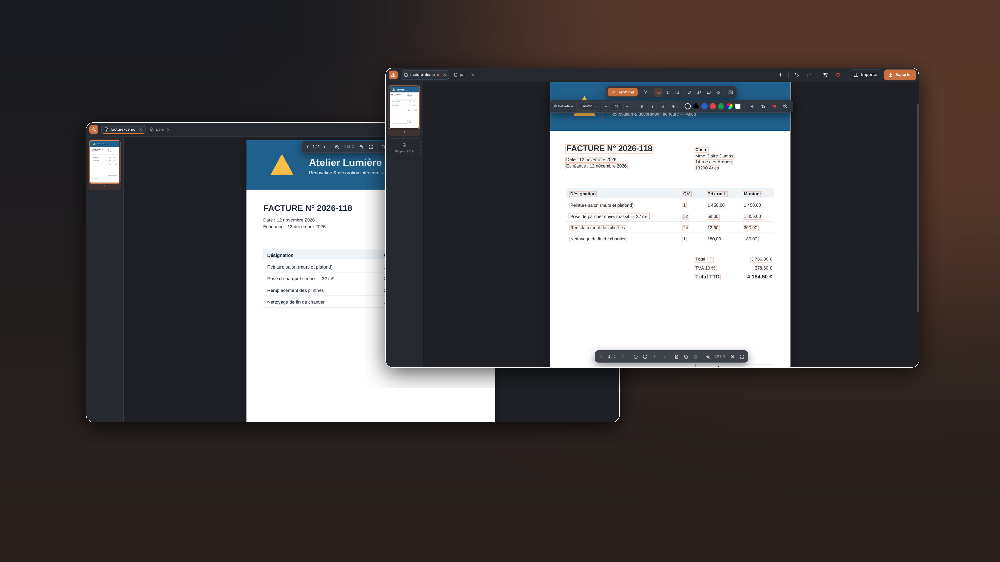
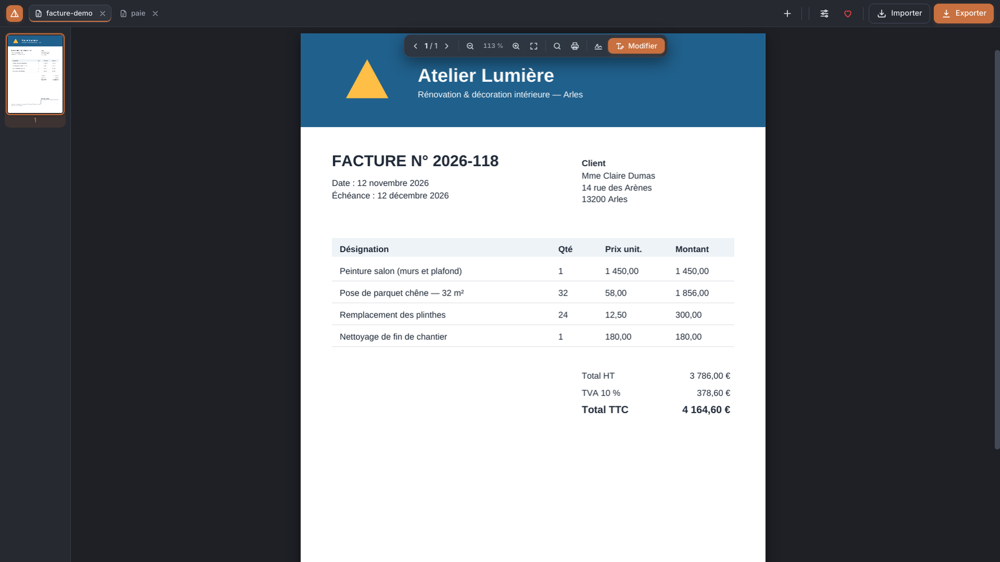
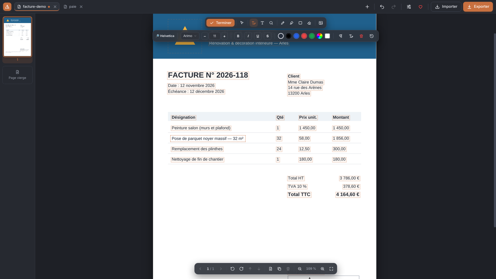
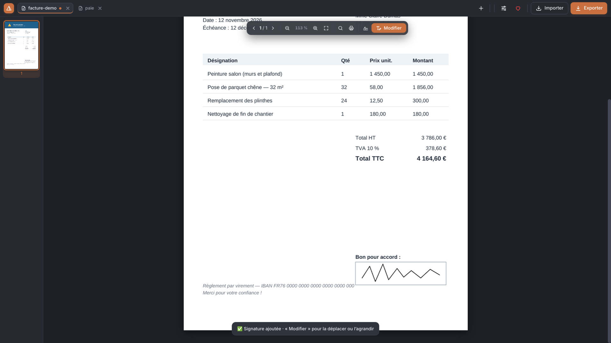
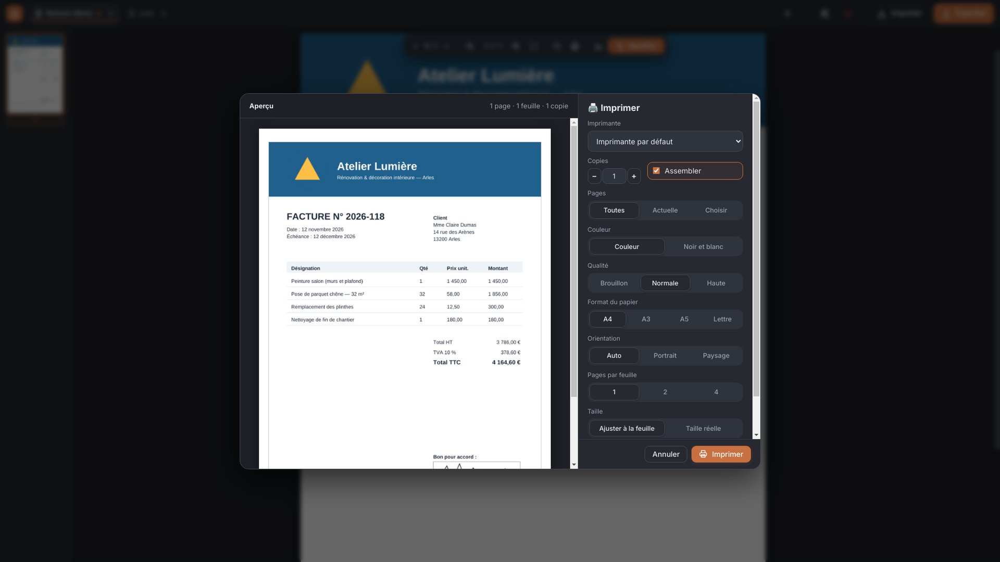

# Pyramid PDF — éditeur PDF gratuit pour Windows

**Lis, modifie, signe et scanne tes PDF, simplement et hors ligne.** Gratuit sur PC, sans compte ni publicité.

## ✨ Fonctions
- ✏️ **Modifier le texte d'origine** d'un PDF : police, taille et couleur retrouvées (factures, devis, formulaires, fiches de paie)
- 🖨️ **Numériser depuis ton imprimante ou ton scanner** (vitre, chargeur, recto verso) et **imprimer** avec aperçu
- 📱 **Scanner avec le téléphone** : QR code, pages redressées et nettoyées, reçues en PDF sur l'ordinateur
- 🔤 **Reconnaissance du texte (OCR)** des pages scannées, hors ligne
- ✍️ **Signature** manuscrite et **signature électronique horodatée**
- 🖼️ Images déplaçables avec repères d'alignement
- 📄 Ajouter, pivoter, réorganiser et fusionner les pages ; ouvrir Word, Excel, images et TIFF
- 🎨 Thèmes, couleurs, dispositions et onglets
- 🔒 Tes documents restent sur ton ordinateur

## 📸 Captures
| | |
|---|---|
|  |  |
|  |  |

## ⬇️ Télécharger
- 🏪 **Microsoft Store** (mises à jour automatiques) : [Pyramid PDF](https://apps.microsoft.com/detail/9NZLS3JH5PJ8)
- 💾 **Installateur Windows** : [dernière version](https://github.com/Fefe-Kurylen/Pyramid/releases/latest)
- 📱 iPhone et Android : bientôt, avec 14 jours d'essai gratuit puis abonnement mensuel

## 💬 Aide
Une question, un souci ? [Ouvre un ticket](https://github.com/Fefe-Kurylen/Pyramid/issues). Politique de confidentialité : [PRIVACY.md](PRIVACY.md).
